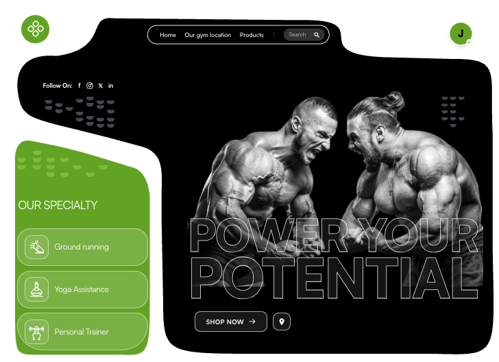

## 📖 Project Background

This project started as a failed interview assignment. I was unable to complete the task because I did not understand how to create the hero section. The main problem was the background design. At first, I tried to create a background with a black and green shape. However, I struggled to position the shape correctly and to place the content properly on top of it. Because of this, the project did not meet the requirements.

After a day of troubleshooting and learning, I finally solved the problem. By carefully adjusting the shape's position and adding the content in a structured way, I was able to fix the background design and complete the hero section. This project now serves as a valuable learning experience and shows how I overcame a specific design challenge.

## solution  image
---

---

---

## 🛠️ Tech Stack

This project is built using the following technologies and packages:

- **Framework:** Next.js ^16.3.8
- **UI Library:** React ^19.0.1 & React DOM ^19.0.1
- **Styling:** Tailwind CSS via PostCSS ^4.3.3
- **PostCSS Integration:**
  - @tailwindcss/postcss ^4.3.3
  - @tailwindcss/vite ^4.3.3
  - postcss ^8.5.28
- **Animation:** Framer Motion ^13.4.4 & Motion ^12.23.24
- **Icons:** Lucide React ^0.546.0
- **Email:** Nodemailer 10.0.16
- **Environment Variables:** dotenv ^17.2.3

---

## 🚀 Getting Started

- **Node.js v22.14.0**

### Installation

1. **Clone the repository:**
   ```bash
   git clone https://github.com/jubaerHasan1234/gyms.git
   cd gyms
    ```
2. **Install all packages:**
   ```
   npm i
   ```
3. **Start the development server:**
```
   npm run dev
   ```
4. **Open your browser and visit**
```
http://localhost:3000
```
